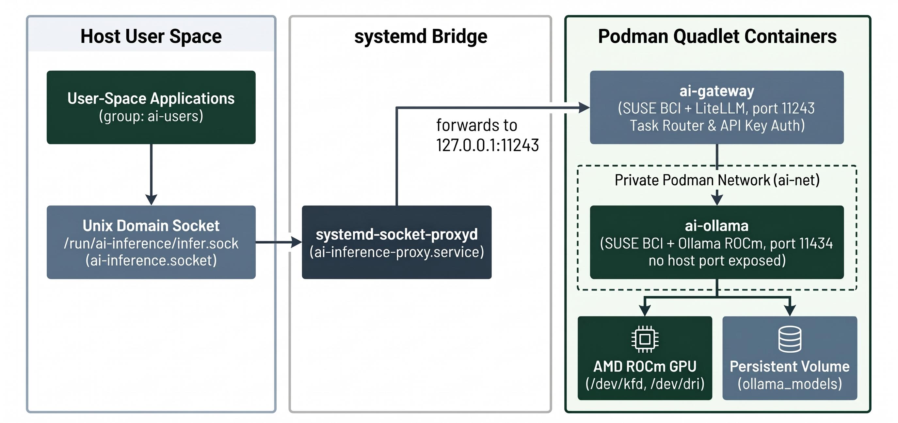

# Hackweek 2026

# llmgw
Containerized task-oriented LLM/AI gateway over a standard Unix socket

## Description & Goals
So far, I have always hard-coded LLM interactions directly into the scripts, automation, and tooling on my machines—both local and cloud. Yet I believe **the future lies in using dedicated, mostly smaller (though not always smaller) and local (though not always local) models tailored to a given task** in most cases on my computer or servers. Furthermore, the AI ecosystem and available models are moving at high speed, and my tooling needs to keep up without me having to touch my scripts every time I switch to a different, better-fitting model for a given task.

Therefore, I need a **local AI gateway and abstraction layer**. 
**the goal of this project is to develop and deploy this abstraction layer on my computer**.

I have something like this in mind:

It meets my 4 basic requirements:
* AI inference is sandboxed in a SUSE BCI container
* AI traffic is gatewayed so I can pick the right model/LLM for a given task or tool
* Local AI inference can utilize the AMD GPU on my computer
* There is a standard interface (Unix Domain Socket) that other apps can use